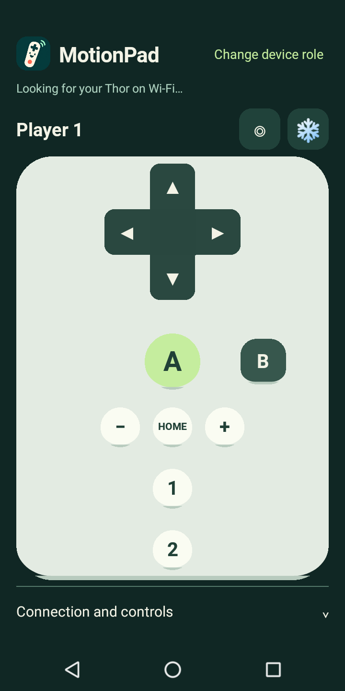
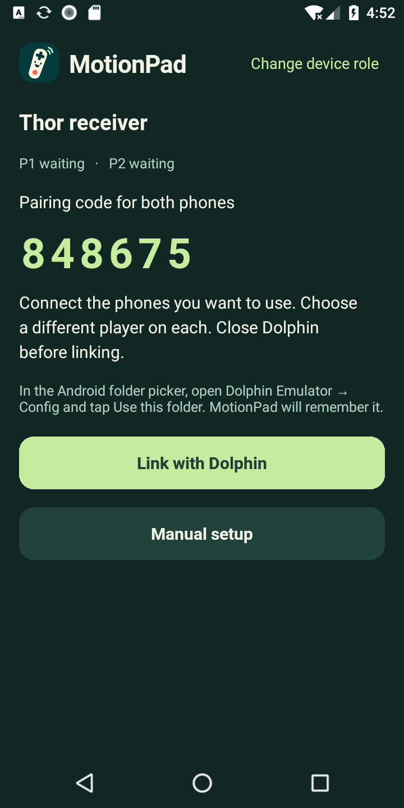
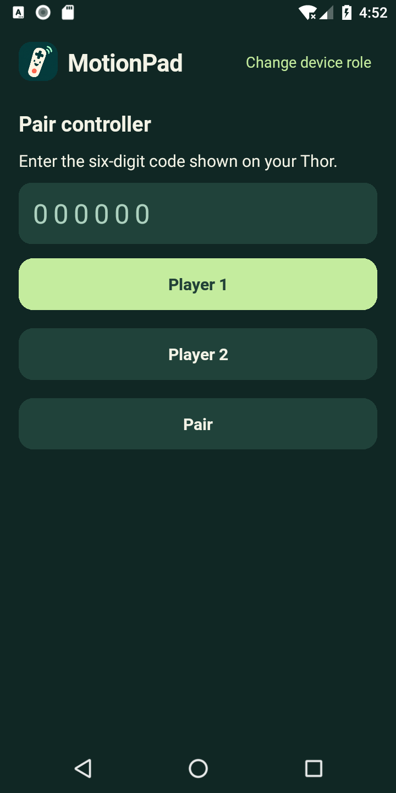
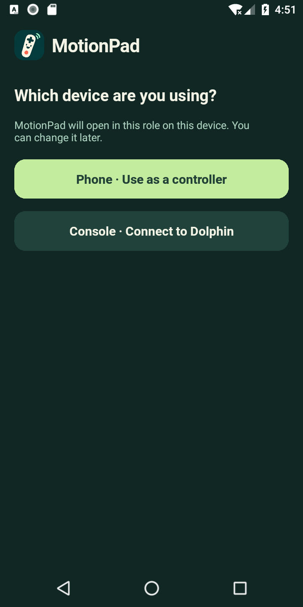
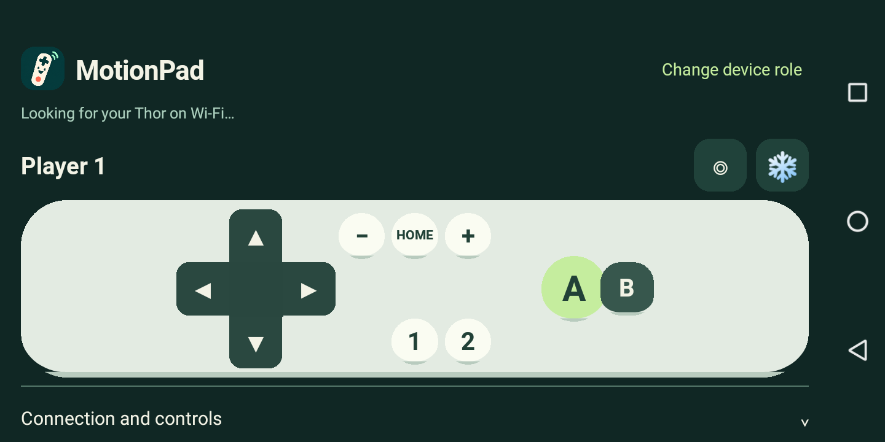

# MotionPad&nbsp; 

## Index

1. [Introduction](#introduction)
2. [Features](#features)
3. [Tools & Technologies](#tools--technologies)
4. [Key Learning Outcomes](#key-learning-outcomes)
5. [Screenshots](#screenshots)
6. [Video Demo](#video-demo)
7. [How to Run](#how-to-run)
8. [Troubleshooting](#troubleshooting)

## Introduction

**MotionPad is an open-source project** that turns Android phones into motion controllers for Dolphin. The source code is available in this repository; see the [build guide](docs/BUILD.md) to build it yourself. Contributions, bug reports and suggestions are welcome.

I wanted to dock my Android handheld, put *Just Dance* on the TV and hand a friend a phone to use as a Wii Remote. With apps like DSU Controller, I kept having to go back into Dolphin and edit `DSUClient.ini`. Sometimes the controller disconnected. Switching Wi-Fi networks was another hassle: DHCP could give my phone a different local IP address, leaving Dolphin pointed at the old one.

I built **MotionPad** to make that routine as close to plug-and-play as I could. The handheld runs a small receiver, so Dolphin always connects to the same local address, `127.0.0.1`. The phones find the receiver over Wi-Fi and remember their pairing. Once I've set up my players, I can take the handheld somewhere else, join the same Wi-Fi on all devices and play without looking up anyone’s IP.

## Features

- **One APK, two roles.** Choose Console on the handheld and Phone on each controller. Each device remembers its role.
- **Dolphin setup.** Link with Dolphin assigns connected players to Wii Remotes 1 and 2, sets unused slots to None and backs up the previous settings.
- **Touch and motion controls.** Slide between D-pad directions while holding another button, tap the crosshair to recenter, or hold the snowflake for one second to freeze the controls while motion stays active. Hold Exit for one second to restore the controls and release screen pinning.

## Tools & Technologies

- **React Native and TypeScript** for the controller, pairing and console screens.
- **Kotlin** for Android sensors, the receiver service and access to Dolphin’s configuration folder.
- **UDP and DSU** to carry button presses and motion data from the phone to Dolphin.

## Key Learning Outcomes

- I learned how to keep Dolphin’s configuration stable even when a phone’s network address changes.
- Testing quick taps, D-pad slides and two phones at once taught me to track touch input and player connections independently.

## Screenshots

  
  
  
  

  

## Video Demo

[Watch the 40-second setup guide (MP4)](docs/demo/motionpad.mp4?raw=true). Follow the on-screen steps to pair a phone, link your players with Dolphin and use Freeze. The guide works with the sound off.

## How to Run

1. Install [**MotionPad.apk**](MotionPad.apk?raw=true) on the handheld and each phone. Connect them to the same trusted Wi-Fi network.
2. Choose **Console** on the handheld. Choose **Phone** on each controller, enter the six-digit console code and select a different player on each phone.
3. If you’ve never opened Dolphin on your handheld, open it once and then close it. In MotionPad on the handheld, tap **Link with Dolphin** and select **Dolphin Emulator → Config**. Your paired phones are now linked as Wii Remotes, and you’re good to go.

For later sessions, open MotionPad on each device. Run Dolphin setup again if you change which player slots you want enabled.

## Troubleshooting

### The phone locks when I turn Freeze off

If leaving Freeze brings up the phone's lock screen and asks for a PIN, pattern, password or fingerprint, this can be caused by an **Android screen pinning setting**. Leaving Freeze releases screen pinning, and Android may lock the device when an app is unpinned. This is separate from the app becoming unresponsive.

To prevent this while keeping the current Freeze behavior:

1. Open the phone's **Settings** and search for **App pinning** or **Screen pinning** (usually under **Security** or **Security & privacy**).
2. Keep screen pinning enabled.
3. If available, turn off **Lock device when unpinning** or **Ask for PIN before unpinning**. The name and availability depend on the phone manufacturer and Android version.
4. Return to MotionPad, enable Freeze, then hold Exit for one second to check the result.

This changes the authentication requirement when unpinning an app; you do not need to remove the phone's normal screen lock. MotionPad cannot override this Android security setting. If your phone does not offer the option, Android may continue to require unlocking after leaving Freeze.

See the manufacturer's [screen pinning instructions](https://help.motorola.com/hc/7132/14/global/en-us/CGT1410105001.html) for an example of this setting.

[Build from source](docs/BUILD.md) · [Network security notes](SECURITY-REVIEW.md)
